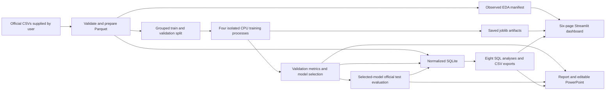

# Application architecture

The Python modules separate validation, storage, fitting, scoring and UI rendering.
`src/config.py` defines six original labels, a seventh derived target and fixed defaults.
`src/data_loader.py` validates CSV headers/record widths and streams 10,000-row Pandas chunks to compressed Parquet.
SHA-256 input fingerprints and quality summaries identify the data behind each experiment.

Each model process reads the same saved split assignments. Within it, one sparse representation feeds seven independent binary predictors. `src/predict.py` is shared by evaluation, live detection and uploaded batches. Constant-class training uses a documented DummyClassifier fallback. `src/evaluate.py` avoids undefined-metric exceptions and restricts the competition mean to six labels.

SQLite builds in a staging file, uses foreign keys/check constraints and batched transactions, and exposes only predefined SQL through read-only connections in the dashboard. `model_runs` and `predictions` contain measured run metadata and held-out validation/test predictions. Model/DB manifest mismatches are rejected. Artifact generation reads actual results or emits explicitly pending sections.

The dashboard never calls fit or training functions. Cached models are invalidated by file modification time. A missing-data session supports navigation and schema inspection, with actionable setup messages. CSV upload and preview limits bound interactive memory use. Full sparse model fitting still holds prepared training text in RAM; it is not an incremental/out-of-core learner.
