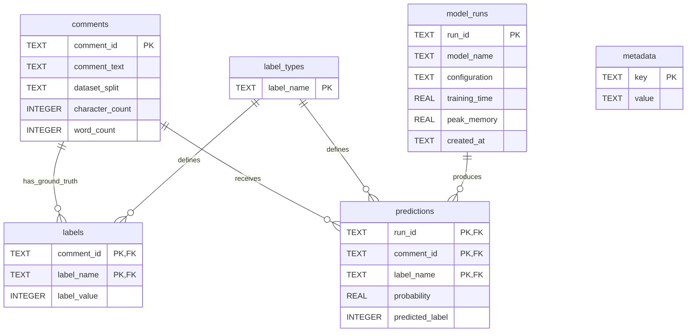

# Relational model

Composite primary keys enforce uniqueness. Ground-truth values are 0/1 only.
Unscored official rows have comments but no ground-truth label records.
`dataset_split=train` identifies the original training source, including validation
rows. Exact train/validation membership is saved per experiment in
`models/<experiment_id>/split_assignments.parquet`; persisted train-source
predictions cover validation only. No training-set predictions enter error analysis.
`metadata` stores the input manifest and is intentionally independent.
Rendered view: `er_diagram.svg`. Schema source: `sql/schema.sql`.
